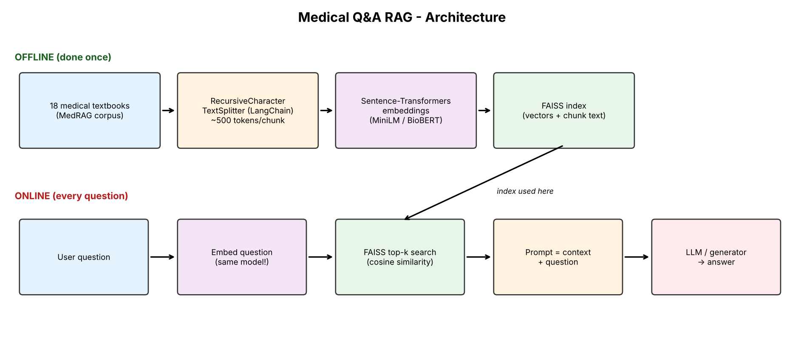

# Medical Q&A Chatbot (RAG) - interview reconstruction

A small, runnable re-creation of the pipeline described in the CV bullet:
**MedRAG corpus -> RecursiveCharacterTextSplitter -> Sentence-Transformer embeddings -> FAISS -> retrieval -> answer -> ROUGE-L + latency evaluation.**

> **Data is SYNTHETIC.** `data/sample_corpus/*.txt` and `data/sample_questions.json` were written for this demo.
> They are *not* the MedRAG dataset and are *not* real textbook text. Do not use for medical decisions.
> No performance claim in the CV is verified by this project (see "Honest limits").



## Setup
```bash
python -m venv venv && source venv/bin/activate     # Windows: venv\Scripts\activate
pip install -r requirements.txt
```
## Run
```bash
python main.py demo                          # build index + 2 sample questions + evaluation
python main.py ask "How is hypothyroidism treated?"
python main.py build --model biobert         # use the BioBERT-based embedding model
python main.py demo --backend lsa            # force the offline fallback (no downloads)
```
First run with sentence-transformers downloads the model from Hugging Face (internet needed, ~90 MB for MiniLM).
If it cannot load, the code prints a message and falls back to an offline TF-IDF+SVD embedding (clearly labelled; not a CV technology).

Optional GPT-3.5 comparison: `pip install openai`, `export OPENAI_API_KEY=...`, then `python main.py eval`.

## Folder map
| File | Role |
|---|---|
| `main.py` | CLI entry point |
| `src/config.py` | all parameters (chunk size, overlap, top-k, model names) |
| `src/data_loader.py` | read documents |
| `src/chunking.py` | LangChain RecursiveCharacterTextSplitter |
| `src/embeddings.py` | Sentence-Transformers (+ offline fallback), L2 normalisation |
| `src/index.py` | FAISS IndexFlatIP wrapper, save/load |
| `src/pipeline.py` | build index; `RAG.ask()` = retrieve + generate + timing |
| `src/generator.py` | local extractive generator, optional GPT-3.5 generator |
| `src/evaluate.py` | ROUGE-L, latency, retrieval hit@k |
| `outputs/sample_output.txt` | real output of `python main.py demo` on this machine (offline fallback backend) |

## Honest limits
* The sample run in `outputs/` used the **offline LSA fallback** (the build machine had no access to Hugging Face). MiniLM/BioBERT code paths are written but were **not executed** there - run them on your laptop before the interview.
* ROUGE-L / latency numbers come from 12 synthetic questions. They do **not** reproduce "5x faster, <3% ROUGE-L drop".
* MiniLM is an embedding model; it cannot generate answers, so "MiniLM vs GPT-3.5" is only meaningful as a comparison of whole pipelines.

## 2-minute demo script
1. **Open** `docs/architecture.png` (10 s): "Offline: split, embed, index. Online: embed question, search, build prompt, answer."
2. **Run** `python main.py demo` (20 s). Say: "It chunks 6 demo documents into 26 chunks and builds a FAISS index."
3. **Input** shown in demo: *What is the first-line drug for type 2 diabetes?* **Show** the retrieved chunks with cosine scores and the answer (30 s).
4. **Open** `src/chunking.py` (15 s): recursive splitter, separators, overlap. **Open** `src/embeddings.py`: normalisation so inner product = cosine. **Open** `src/index.py`: IndexFlatIP.
5. **Open** `src/pipeline.py` `RAG.ask` (15 s): retrieve -> generate, timed separately.
6. **Open** `src/evaluate.py` (15 s): ROUGE-L + hit@k. Say honestly: "This toy set only proves the method; the CV numbers came from the full benchmark."
7. **Close** (15 s) with one limitation (extractive answer quality / exact search at scale) and one improvement (reranker, hybrid BM25).
